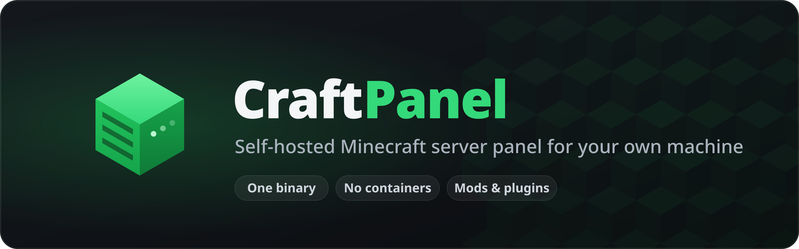

<p align="center">
  
</p>

<p align="center">
  <a href="https://github.com/MCbabel/craftpanel/actions/workflows/ci.yml"></a>
  <a href="https://github.com/MCbabel/craftpanel/releases/latest"></a>
  <a href="LICENSE"></a>
</p>

**CraftPanel** is a web panel for running Minecraft servers on a single Linux machine. It installs
as one program with an embedded web interface and a small privileged helper — no daemon cluster, no
message queue, no containers. Every panel user gets an isolated system account with its own
resource limits, and running servers keep running while the panel itself is updated.

The interface is built on [Modrinth](https://modrinth.com)'s open-source UI library, so browsing
and installing mods and plugins feels the way it does on Modrinth.

## Features

- **Server management** — create, start, stop, restart and kill servers, with a live console and
  live CPU, memory and storage metrics.
- **Loaders** — Vanilla, Paper, Folia, Purpur, Leaf, Fabric and Velocity, each downloaded and
  checksum-verified.
- **Content** — search, install, update and remove mods and plugins straight from Modrinth, one at a
  time or in bulk.
- **Files** — browse, edit, upload, unpack, move and download server files in the browser.
- **Backups** — manual and scheduled backups that save the world consistently, with optional
  off-site copies in each user's own Google Drive.
- **Users and access** — admin and user roles, per-server roles (owner, editor, viewer),
  invitations and an audit log.
- **Sign-up** — off, open, or open with admin approval, always with e-mail verification.
- **Resource limits** — memory, CPU, process and disk limits per user, enforced with cgroups.
- **Public addresses** — one [playit.gg](https://playit.gg) tunnel per server, no port forwarding
  needed.
- **Java runtimes** — the right Eclipse Temurin JRE for each Minecraft version is fetched
  automatically.
- **Responsive, bilingual UI** — works on desktop and phone, in English and German, with light,
  dark and OLED themes.

## Quick start

Requirements: a Linux machine with **systemd** and **cgroup v2** (x86_64 or aarch64).

```bash
curl -fsSL https://github.com/MCbabel/craftpanel/releases/latest/download/install.sh | sudo bash
```

The installer asks for the web port, the port range for game servers and an administrator name,
then prints the generated password once. Open `http://<your-server>:<port>` and sign in.

Running the installer again offers to update or uninstall. Prefer not to pipe a script into a root
shell? See [Installation](docs/installation.md) for verifying the download first, pinning a version
and installing from a bundle you built yourself.

## Documentation

| Guide | |
|---|---|
| [Installation](docs/installation.md) | Requirements, installing, updating, uninstalling |
| [Configuration](docs/configuration.md) | Config file, data directory, panel settings |
| [Accounts and access](docs/accounts.md) | Roles, invitations, sign-up, password reset, limits |
| [Google Drive backups](docs/google-drive.md) | Off-site backups to each user's own Drive |
| [Mail](docs/mail.md) | Verification and password reset mails with Resend |
| [Public addresses](docs/playit.md) | Reaching servers from outside with playit.gg |
| [Java runtimes](docs/java.md) | Which Java each server gets and where it comes from |
| [Architecture](docs/architecture.md) | How the panel, helper and supervisors fit together |
| [Upgrading](docs/upgrading.md) | Updating and migrating older installations |

## Scope

CraftPanel is a tool for **your own machine**, not a hosting business:

- One machine — no nodes, agents or clusters.
- Linux only — system accounts, cgroup v2 and systemd are load-bearing.
- No billing, plans, subdomains, DNS or SFTP.
- NeoForge, Quilt and Forge are listed but not supported yet. Spigot and CraftBukkit are not
  offered because they may not be redistributed; Bedrock is out of scope.

Google Drive backups, mail and playit.gg each need an account of your own and stay switched off
until you set them up.

## Building from source

```bash
pnpm install
pnpm --filter @craftpanel/web build   # the interface is embedded into the binary
cargo build --release
```

`scripts/release.sh` builds the statically linked release bundle. See
[CONTRIBUTING.md](CONTRIBUTING.md) for the development setup and the checks CI runs.

## Contributing and security

Contributions are welcome — please read [CONTRIBUTING.md](CONTRIBUTING.md). Security issues should
be reported privately as described in [SECURITY.md](SECURITY.md).

## License

CraftPanel is licensed under the **GNU General Public License v3.0 only** — see [LICENSE](LICENSE).
The interface includes code from Modrinth's UI library (GPL-3.0-only) and API client
(LGPL-3.0-only); details and the list of changes are in [COPYING.md](COPYING.md).

CraftPanel is not affiliated with or endorsed by Rinth, Inc., Mojang Studios or Microsoft.
Minecraft is a trademark of Mojang Studios.
